# Memory Palace

### Your camera roll, turned into a place you can walk through—and revisit together.

Memory Palace is a personal-memory workspace: bring in photos and videos, organize the moments around them, step into a photo-derived 3D scene, and invite someone to explore that same memory with you. It connects the whole loop—**remember → find → step inside → share**—instead of treating memories as another feed.

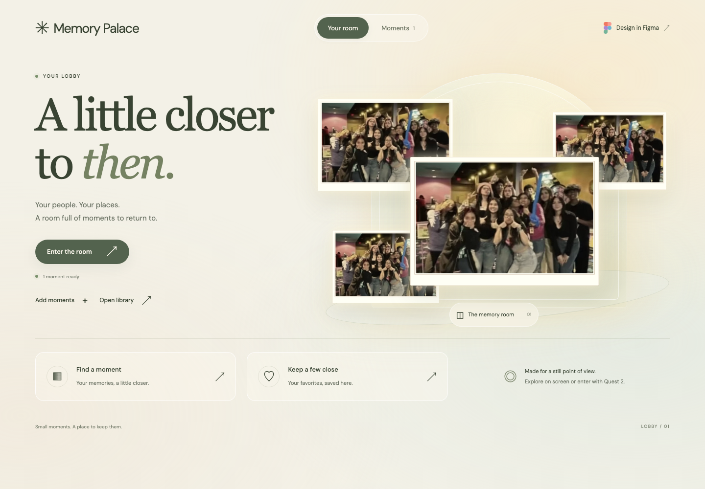

*Live app screenshot. The lobby includes a bundled Figma sample collection so the experience is visible before a personal archive is connected.*

## What makes it different

- **A memory, not a venue demo.** The scene is requested from the selected photo or video and built from its visual content. There is no fixed demo room substituted for the memory. Depth, people, objects, and unseen surfaces are estimates—not a metric scan or a promise to recover information a single image never captured.
- **The archive stays connected to the experience.** Keep the source photo, date, location, description, tags, and related memories beside the reconstructed scene. Search, folders, suggested albums, timelines, and editable chapters help you find a moment again.
- **Remember with another person.** Invitation-only rooms share the selected memory and participant presence across desktop, phone, and Meta Quest. Each person controls their own view; the host controls the shared memory.
- **Imports are deliberate.** Choose specific Google Photos items in Google’s Picker, paste a shared-album link only with permission, or request a bounded Apify import for an account you own or are authorized to use.

## The full experience

### 1. Start with onboarding

On first launch, onboarding introduces the personal archive and asks you to choose how to bring memories in. You can connect a source, upload files, or skip and do this later. The lobby is the welcome point—not the place to browse a personal archive before it has been connected.


*The lobby is the entry point; its bundled sample is only there to preview the spatial experience.*

### 2. Connect a source and choose what to import

Upload JPEG, PNG, WebP, MP4, or WebM files, or pick a connected source. These are explicit import flows: connect first, then choose the media you want in your archive.

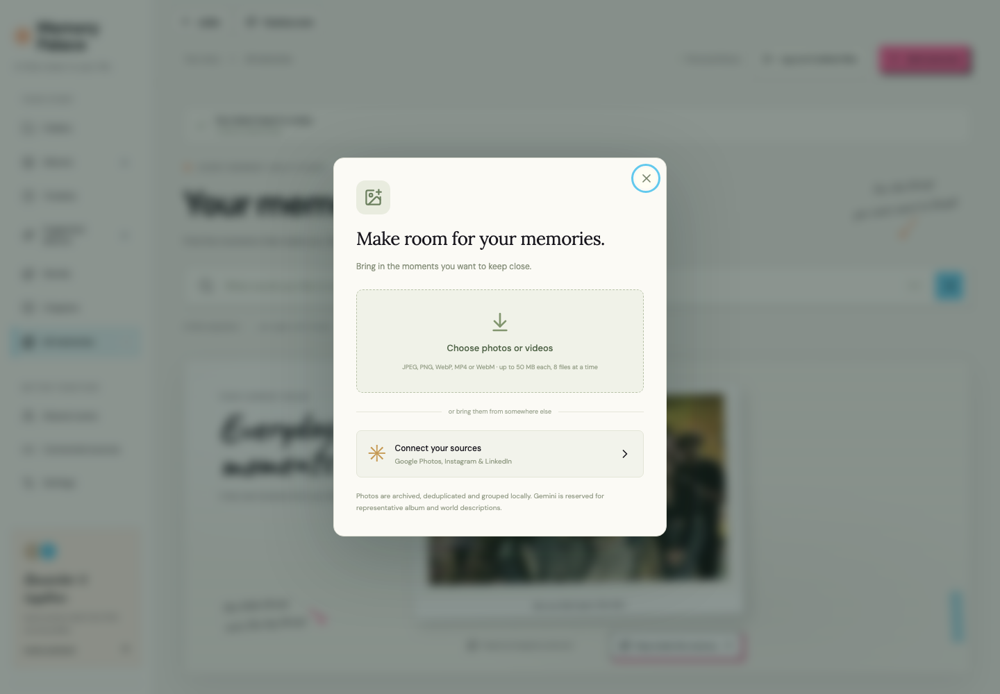

Google Photos requires your own OAuth setup and a selection in Google’s Picker. Memory Palace cannot silently browse or auto-select your recent library.

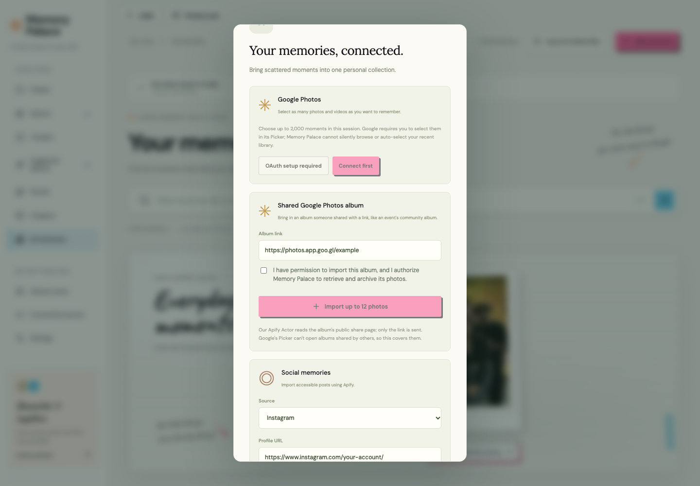

For a shared Google Photos album, provide the share link and confirm that you have permission before importing. The screenshot uses a generic example URL; the import was not submitted.


Social imports use Apify. The form asks for the profile/channel URL and two separate confirmations: that you own the account or have permission, and that you authorize retrieval and archiving. The example URL is generic and the boxes are unchecked in this screenshot; no Apify run was submitted. The server—not the browser—holds `APIFY_TOKEN`; Memory Palace does not ask for a social password.

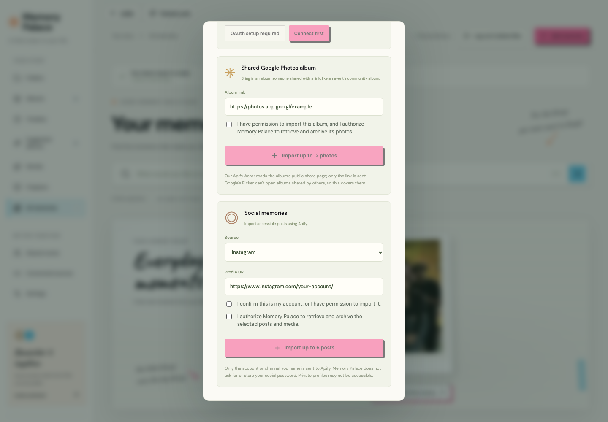

### 3. Process and save the imported memories

The upload dialog shows the real in-progress state. Imports are validated, archived, and organized before they become part of the browsable library. This capture uses one image bundled with the repository as a sample, not anyone’s private camera roll.

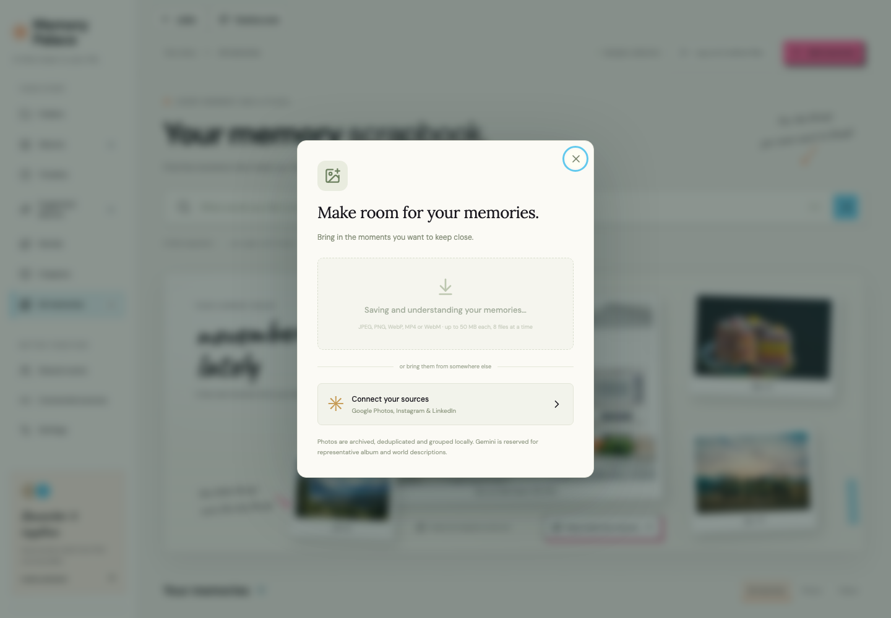

Only after processing finishes does the imported memory appear in the library with its source and editable context. Original media remains available beside the generated view.

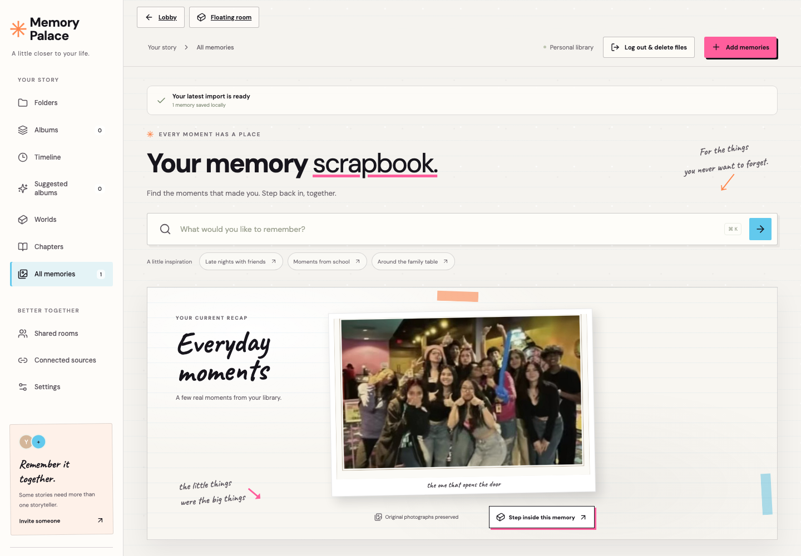

### 4. Browse your connected archive

Now browse and search the memories you imported, revisit their details, and enter the spatial room. The bundled floating-photo collection is a preview fallback; connected library memories are the ones to revisit and step inside.

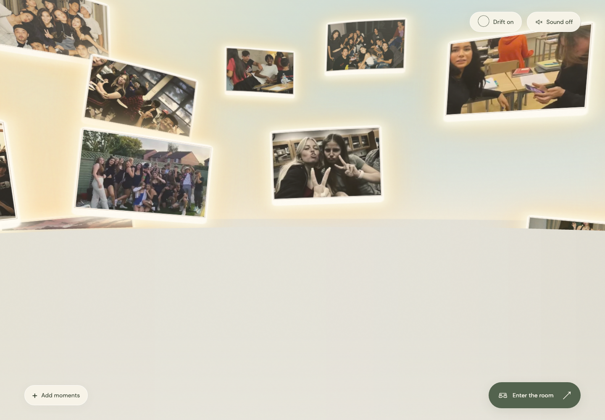

### 5. Open a memory and request its scene

Open a memory to review it, edit its details, build a chapter, or choose **Step inside this memory**. That action requests a new scene from this photo; it does not reuse the lobby’s floating-photo sample as the world.

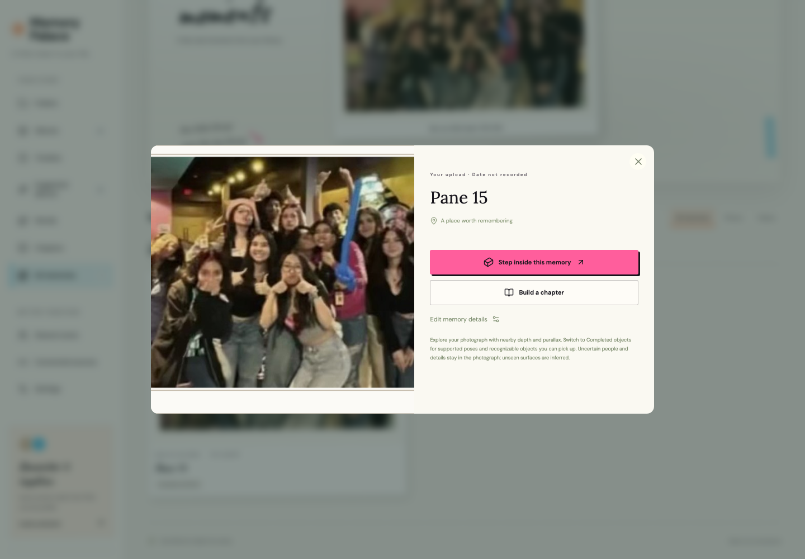

The app shows the transition while the scene is being prepared. The first reconstruction can take longer while local model assets are initialized; later visits can reuse cached work.

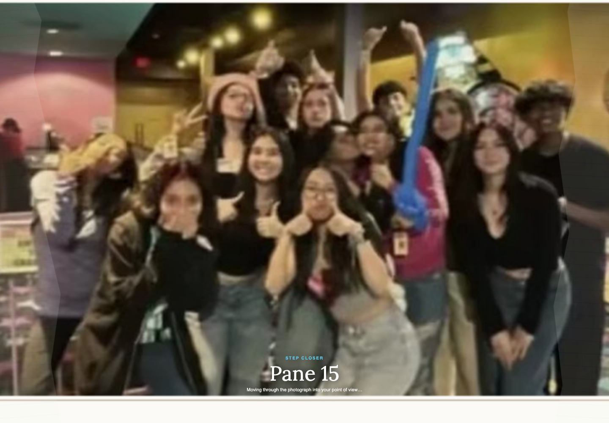

The resulting viewer uses estimated depth and geometry from the selected photo. Walk mode supports movement and viewpoint changes; Inspect mode exposes orbit controls and scene details. The original photograph remains visible as the source reference.

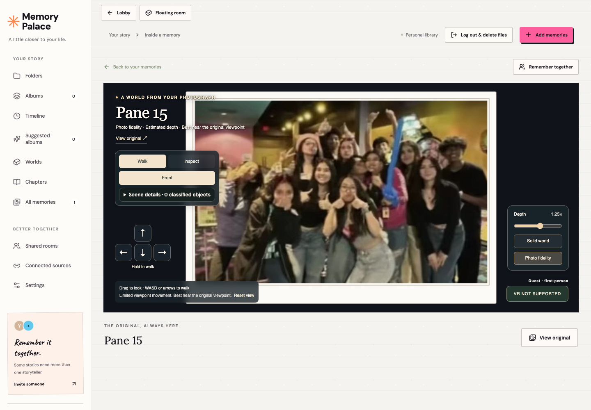

### 6. Invite someone into the same memory

Open **Remember together** to start a shared room or join with an invitation code. This screenshot shows the dialog only; it does not create a live room. Once connected, SpacetimeDB synchronizes room membership, host-selected memory, and participant poses.

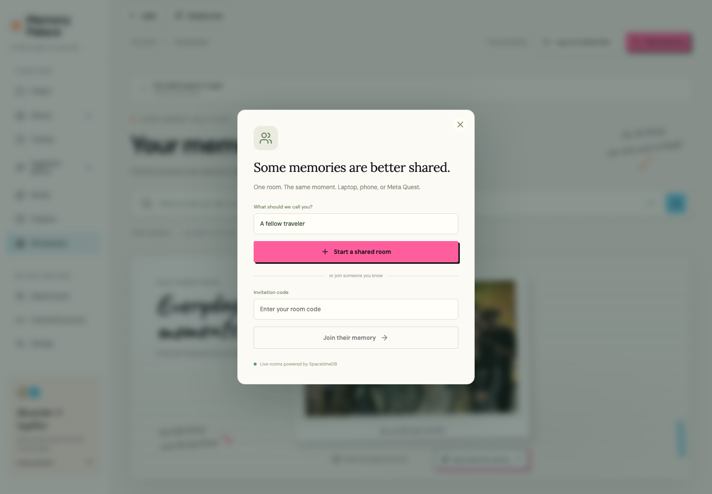

## How the product works

1. **Import:** media is validated and archived locally. Import jobs preserve source context and consent, detect duplicates, and organize files into a common library.
2. **Find:** browse folders and suggested albums, edit metadata, search in your own words, and build a timeline or chapter from selected memories.
3. **Reconstruct:** Depth Anything V2 estimates depth locally. Scene processing uses image-derived masks and geometry, with optional configured semantic assistance. A scene is a best-effort reconstruction from the available view; scale and unseen surfaces are inferred.
4. **Explore:** the Three.js viewer offers Walk and Inspect modes, depth controls, useful viewpoints, and Quest entry when WebXR is available in a secure context.
5. **Share:** invitation-only SpacetimeDB rooms synchronize the shared memory selection and presence. Participants navigate independently. Voice chat is not implemented.

### Provider setup and privacy

Copy `.env.example` to `.env` and add only the providers you intend to use. Keep all secrets server-side; never use a `VITE_` variable for a credential.

```dotenv
# Optional Gemini features
GEMINI_API_KEY=

# Optional Apify imports (set the actor(s) you use as well)
APIFY_TOKEN=

# Google Photos OAuth + Picker
GOOGLE_CLIENT_ID=
GOOGLE_CLIENT_SECRET=
```

Google Photos is a user-selected Picker flow, not unrestricted whole-library access. Apify imports start only after an explicit request with a profile URL, authorization checks, and a configured actor. Shared albums require permission confirmation. See [integration setup and API behavior](docs/integrations.md).

### More than a 3D viewer

- **Recall:** natural-language search, editable titles/descriptions/tags, date and location context, private suggested albums, timelines, and editable chapters.
- **Photos:** locally estimated depth, walk/inspect controls, original-photo comparison, and best-effort people/object geometry. It preserves the source image; it does not claim to reveal hidden details as fact.
- **Videos:** sampled scene frames, playback, pause, sound, and scrubbing in the viewer. Common objects can be recognized and interacted with in photo scenes; video objects remain locked.
- **Together:** invitation-code rooms synchronize the host’s selected memory and participants’ positions. Guests explore independently; voice chat and full-body live avatars are not implemented.

Uploads, metadata, generated scenes, and model caches live under ignored `data/` on the server machine. This is a trusted-device prototype, not a public multi-user cloud archive; add authentication and per-user authorization before exposing the media API to the Internet. OAuth grants are held in server memory and must be reconnected after a restart.

## Run locally

Requires Node.js 22 or newer.

```sh
npm ci
cp .env.example .env
npm run dev
```

Open [http://localhost:5173](http://localhost:5173). The development server runs the web app and API. For another device, use the Network URL printed by Vite; every participant must reach the same API/media server. Provider integrations are optional, but require your own credentials and consent setup.

## Routes

| Route | Experience |
| --- | --- |
| `/` or `/lobby/` | Lobby and memory entry points |
| `/room/` | Floating-photo room |
| `/room/?template=1` | Bundled 29-photo visual sample |
| `/library/` | Archive, search, albums, scenes, and multiplayer |
| `/library/?import=1` | Open the add-memories flow |
| `/preview/` | Lobby/room comparison preview |
| `/storyboard/index.html` | Motion study |

## Verify

```sh
npm run typecheck
npm test
npm run build
npm --prefix spacetimedb ci
npm --prefix spacetimedb test
```

The app tests cover imports, persistence, metadata, reconstruction, scene validation, and room synchronization. `src/multiplayer/live-smoke.ts` is an opt-in test that creates temporary rooms against Maincloud and removes them afterward.

## Code tour

- [`src/App.tsx`](src/App.tsx) connects the library, imports, selected-memory detail, scene request, and room controls.
- [`server/import-pipeline.ts`](server/import-pipeline.ts) validates and archives import batches, records provenance, deduplicates media, and creates background jobs.
- [`server/app.ts`](server/app.ts) exposes the API, including `POST /api/upload` and `POST /api/memories/:id/scene`.
- [`server/reconstruction.ts`](server/reconstruction.ts), [`server/depth-model.ts`](server/depth-model.ts), and [`server/world-completion.ts`](server/world-completion.ts) build and enrich media-derived geometry; scene and cache contracts are documented in [`docs/reconstruction.md`](docs/reconstruction.md).
- [`src/components/MemoryWorld.tsx`](src/components/MemoryWorld.tsx) renders the scene and implements walking, inspection, media controls, and WebXR entry.
- [`src/multiplayer/index.ts`](src/multiplayer/index.ts) connects clients to the room reducers and subscriptions in [`spacetimedb/src/index.ts`](spacetimedb/src/index.ts).

## Project notes

- The screenshots above are real browser captures of this application. The 3D viewer capture was generated from the repository’s bundled sample image with local depth inference. The Google, Apify, and multiplayer screens are workflow states only; no provider import, OAuth login, or live room was submitted during capture.
- To regenerate them, run the app locally and execute `node scripts/capture-readme-ui.mjs`. It uses one repository-bundled sample image for the upload/reconstruction walkthrough; provider and multiplayer forms are not submitted.
- Reconstruction is approximate: one photograph cannot provide true unseen views, measured room dimensions, or a complete scan of a person. Video scenes use sampled frames and have additional limits.
- The app does not publish a public social feed. Shared rooms use private invitations; rooms expire when their last participant leaves.
- Voice chat, fully reconstructed 360° surroundings, user accounts, and public-cloud media storage are not implemented.

For deeper technical detail, see the [album/import pipeline](docs/albums-and-import-pipeline.md), [reconstruction design](docs/reconstruction.md), [neural reconstruction notes](docs/neural-reconstruction.md), [SpacetimeDB multiplayer](docs/spacetimedb.md), [integration guide](docs/integrations.md), and [acceptance checklist](docs/acceptance.md).

## Take your memories into VR

Once an import is finished, you can go from the memory straight to its generated 3D model: open the memory and choose **Step inside this memory**. The model is generated from that selected photo or video; this is not a general-purpose uploader for arbitrary `.glb`/`.gltf` assets, and the lobby sample is not substituted for your memory.

### Explore the 3D model


On desktop, choose **Walk** to move through the estimated scene with WASD or the arrow controls, or **Inspect** to orbit around it with drag and zoom with the scroll wheel/pinch. Use the viewpoint buttons and depth controls to examine the reconstruction; switch between the source-photo surfaces and completed-object view where available. Scene details identify which objects are represented in 3D and which remain preserved in the photograph. Supported 3D objects can be dragged in the browser or picked up with Quest controllers. These are inferred shapes and surfaces from a single view, not a complete scan of hidden sides or the real room.

On Meta Quest, Memory Palace runs in Quest Browser as an immersive WebXR experience (it is not a separately installed Quest app). The headset supplies the stereo view and head tracking; the viewer supplies the reconstructed world, controller rays, locomotion, and object interaction. Movement is virtual joystick locomotion, not a promise that the reconstructed room matches your physical room or play-space dimensions.

#### Quest walkthrough

1. Open the same Memory Palace app/API that holds the imported media, then open the processed memory and wait for its 3D scene to finish loading.
2. Before entering VR, choose **Completed objects** if you want to pick up supported objects. **Photo fidelity** keeps the photographed surface close to its source viewpoint and intentionally limits movement; in that mode object pickup and floor teleport are unavailable. The source photo and its reconstruction are still estimates, not a scan of hidden sides.
3. In Quest Browser, select **Enter VR**. The browser requests an immersive headset session. If this control is missing or cannot start, check that Quest Browser supports WebXR on the current secure origin, allow the browser’s headset permission, and try the USB localhost or trusted HTTPS setup below. Use the headset’s system menu/“Exit VR” control to leave immersive mode and return to the normal browser viewer.
4. Look around naturally to inspect the scene in stereo. Use the **left thumbstick** to walk within the reconstructed world; movement is kept inside scene bounds and steers around supported obstacles. Use the **right thumbstick** for discrete snap turns. To teleport, point a controller ray down at a reachable, clear floor location until the floor reticle appears, then press the trigger. Teleport is disabled in Photo fidelity mode.
5. To handle a supported movable object, point at it and hold the controller’s **grip/squeeze** button; move it, then release to place it. This works for image memories in Completed objects mode, not in point-cloud or Photo fidelity mode. Not every photographed object has a separate interactive 3D model—some detail remains part of the source-photo surface. For video memories, the trigger on the scene toggles playback; video objects stay locked.
6. To explore with someone else, have them open the same deployment and join using the room code from **Remember together** on a phone, laptop, or another headset. The room synchronizes the selected memory and participant head poses; each person navigates their own view. The room code does not transfer the media itself, so each device still needs access to the same app/API library. Voice chat is not included.

The normal viewer’s **Walk/Inspect**, depth, viewpoint, and scene-detail controls are available before entering the headset. In-headset, use the controllers and the viewer’s VR-specific prompts; exit VR to return to those browser controls. WebXR/Quest behavior should be verified on a physical headset—desktop emulation cannot confirm headset permissions, comfort, or performance.

### Try it on Meta Quest over USB

Run the app and API on your computer, connect the Quest by a USB data cable, enable Developer Mode, and approve USB debugging in the headset. Install the [Meta VR CLI](https://developers.meta.com/vr/essentials/metavr-install/), then check and open the app in Quest Browser:

```sh
npm run vr:devices
npm run vr:check
npm run vr:deploy
```

Keep the computer and server running and the USB connection attached. The helper validates the connected device is a Quest, forwards the app port to headset localhost, and launches Quest Browser at that local origin so WebXR can use a secure context. Then follow the Quest walkthrough above. For the development-server variant, first run `npm run dev` and use `npm run vr:dev`; for the production helper, start the API/app with `npm start`, then run `npm run vr:deploy` (it builds the web app before opening it in Quest Browser). See the [Quest deployment helper](scripts/quest-deploy.mjs) for details.

### Access from another device or over the Internet

For a laptop or phone on the same network, use the Network URL printed by Vite; all participants must reach the same running app/API server. A plain LAN `http://` address is not enough for immersive WebXR in Quest Browser: use the USB localhost workflow above or serve the app over trusted HTTPS. On Quest over Wi-Fi, open that HTTPS app URL directly in Quest Browser; connect Quest and the other devices to the same deployment/API, not just the same room code.

To join from outside your network, the app and API need a reachable HTTPS origin, the same origin must be configured for provider callbacks as applicable, and the multiplayer service must be reachable by every participant. Use a private VPN or an authenticated HTTPS deployment. **Do not expose this prototype’s media API directly to the public Internet:** it has no user accounts or per-user media authorization, and its uploads, metadata, scenes, and caches are stored on the server machine. Put authentication and per-user authorization in place before public hosting, and use private storage appropriate for personal photos. Once safely reachable, participants can open the same deployment and share a room code to explore one memory together.
